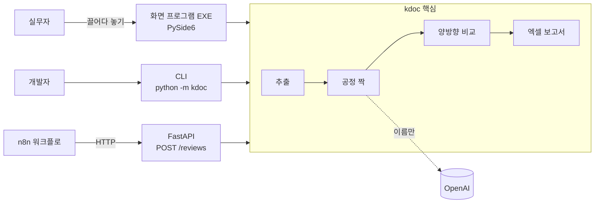

# kdoc — 건설 설계도서 불일치 검토 보조 도구

시방서(PDF)와 내역서(엑셀)를 넣으면 **두 문서 사이의 누락·수치 불일치 의심 항목**을 원본 페이지·행 링크와 함께 엑셀로 정리해 주는 도구입니다.

공무 업무에서 시방서와 내역서를 공정별로 맞대어 손으로 대조하던 작업을 자동화했습니다. 오류를 확정하는 도구가 아니라 **검토할 위치를 먼저 찾아 주는 보조 도구**입니다.

<!-- 스크린샷: 화면 프로그램과 결과 엑셀 캡처를 docs/images/ 에 넣고 아래 주석을 해제하세요.


-->

## 무엇을 하나

| 단계 | 내용 |
|---|---|
| 수집 | 나라장터(G2B) 공고 첨부 설계서를 내려받고 sha256 기록 |
| 추출 | 시방서 → 장·조항·페이지, 내역서 → 공종 계층·품명·규격·수량·행 번호, 도면 → 문자·좌표 (스캔 페이지는 OCR 대상 표시) |
| 공정 짝 | 시방서 장 ↔ 내역서 공종. 이름이 같으면 규칙, 다르면 OpenAI(장·공종 **이름만** 전송), 사용자 CSV 지정이 최우선 |
| 비교 | 짝 안에서 양방향 비교 — 시방서 자재가 내역서에 없음 / 내역서 자재가 시방서에 없음 / 같은 부위의 두께·횟수 차이 |
| 결과 | 5개 시트 엑셀(요약·공정 짝·시방서→내역서·내역서→시방서·안내). 각 행에 PDF `#page=N`, 엑셀 `시트!A행` 링크 |

## 사용 방식 3가지



- **화면 프로그램(EXE)**: 개발을 모르는 실무자용. 시방서·내역서·도면 칸에 파일을 넣고 [검토 시작]. 결과 표를 더블클릭하면 원본 해당 쪽이 열립니다.
- **CLI**: `python -m kdoc review --spec a.pdf --boq b.xlsx [--no-ai]`
- **API + n8n**: `POST /reviews` → 보고서 UUID 발급 → `GET /reviews/{id}/report`로 엑셀 다운로드. n8n 워크플로에서 성공/실패(404·409·422)를 분기합니다.

## 운영 자동화 (n8n, v2 — 진행 중)

계획과 사전 등록 지표는 [docs/PLAN_v2.md](docs/PLAN_v2.md). 워크플로 JSON은 `n8n/build.py`로 만들고 `docker\import_workflows.bat`으로 가져옵니다.

| 워크플로 | 하는 일 |
|---|---|
| W1 나라장터 감시 | 매일 07:00 공사 입찰공고 검색(키 없이 통합검색) → 필터 → 첨부 파일명으로 시방서·내역서 분류 → 받아서 검토 → 알림함 |
| W2 업로드 폼 | 실무자가 n8n 폼에 시방서·내역서를 올리면 검토 결과 엑셀 링크를 돌려줌 |
| W3 판정 폼 | 결과 엑셀의 `판정` 열(진짜 문제 / 문제 아님 / 판단 못 함)을 올리면 정밀도를 집계 |
| W4 운영 | 워크플로 실패 기록·알림, 10분 상태 점검(복구 시 장애 시간 알림), 주간 운영 요약 |
| W5 질의서 초안 (선택) | 의심 항목(자재·위치만, 본문 없음)으로 설계 질의서 초안을 LLM이 작성 |

- 알림은 메신저 없이 알림함 화면(`http://127.0.0.1:8000/ui/alerts`)에 쌓입니다.
- 첫 실행(2026-11-11): 공고 54건 → 필터 통과 41건 → 새 공고 30건 처리. **시방서까지 첨부된 공고는 1건**뿐이었고(시방서 없음 13 · 시방서·내역서 없음 8 · HWP만 4 · 첨부 없음 4), 그 1건은 처음엔 시방서 양식(`제1 장` 다음 줄에 제목) 때문에 추출에 실패 → 추출기 수정 후 검토 완료.
- 나라장터 검색은 공개 API가 아닌 화면 내부 요청이라 바뀔 수 있습니다. 응답 구조가 바뀌면 W1이 실패로 멈추고 W4가 알립니다. 요청 간격 1~2초, 하루 요청 상한, 403·429면 중단합니다.

## 결과 예시 (P1: 국립국악고 기숙사 화장실 개선공사)

공개 공고 문서로 실행한 결과입니다 (`review --project P1 --no-ai`, 약 1.4초).

| 항목 | 값 |
|---|---|
| 시방서 장 / 내역서 공종 | 16 / 20 |
| 공정 짝 (이름 일치) / 판단 불가 | 7 / 22 |
| 내역서에 없음 의심 / 시방서에 없음 의심 | 10 / 3 |

예: 시방서 24쪽의 **우레탄 방수**가 내역서 방수공종에 없고, 내역서의 **시멘트 액체방수**는 시방서 방수 장에 없음 → 두 문서의 방수 공법이 다를 가능성.

## 성능

내역서에 불일치 31개를 고정 시드로 심고 찾아내는지 측정했습니다 (`python -m kdoc bench`, AI 없이 규칙만). 방법과 사례는 [docs/benchmark.md](docs/benchmark.md).

| 지표 | 값 | 측정 방법 |
|---|---|---|
| **검출률 (전체)** | **77% (24/31)** | P1~P3 내역서에 불일치를 심고 정확한 자재·장 위치로 나오는지 확인 |
| └ 자재 누락 · 자재 추가 · 공종 누락 | 9/9 · 9/9 · 6/6 | 관계없는 새 의심 항목(부작용) 1건 |
| └ 수치 변경 | **0/7** | 7건 모두 `판단 불가`로만 표시 — 실제 문서는 한 줄에 치수·부위가 섞여 있어 단일 수치 대응이 안 됨 (개선 과제) |
| 처리 시간 | 공고 1건 0.7~2.9초 | 추출 + 공정 짝 + 비교 |
| 정밀도 (실제 공고 의심 항목) | 측정 예정 | 실제 의심 항목을 직접 판정 |
| 검토 시간 | 측정 예정 | 수작업 대조 vs 결과 확인, 1인 측정 |

> 추출 이후 단계(공정 짝·비교)의 성능이며, 후보가 적어 표본이 작습니다. 자재 사전에 없는 자재는 대상이 아닙니다.

## 빠른 실행

```powershell
python -m venv .venv
.venv\Scripts\python -m pip install -e ".[dev,api]"
.venv\Scripts\python -m kdoc fetch --project P1    # 공고 첨부파일 수집 (원본은 저장소에 포함하지 않음)
.venv\Scripts\python -m kdoc review --project P1 --no-ai
.venv\Scripts\python -m kdoc bench               # 검출률 측정 (P1~P3 수집 후)
.venv\Scripts\python -m pytest
```

- API: `python -m uvicorn kdoc.api:app --port 8000` → `http://127.0.0.1:8000/docs`
- n8n + API: `docker\up.bat` (자세한 절차는 [상세 문서](docs/DETAILS.md#검토-api와-n8n-데모))
- EXE 만들기: `build_exe.bat` → `dist\kdoc\kdoc.exe`

## 설계에서 고민한 점

- **규칙 우선, AI는 좁게**: 자재는 사전(`config/materials.txt`), 수치는 숫자+단위(mm·회·겹·MPa·T)만 규칙으로 비교합니다. AI는 이름이 다른 공정 짝짓기에만 쓰고, 결과를 캐시하며 실행당 호출 수에 상한을 둡니다.
- **문서 외부 전송 최소화**: AI에는 장·공종 이름만 보내고 본문은 보내지 않습니다. API 키는 윈도우 자격 증명 관리자(keyring)에 저장하고 EXE·결과 파일에는 남기지 않습니다.
- **판단할 수 없으면 "판단 불가"**: 부위·단위가 대응되지 않는 수치는 억지로 비교하지 않고 후보 위치만 보여 줍니다.
- **재현 가능성**: 원본은 `config/sources.yaml`로 언제든 다시 받고(sha256 기록), API 검토는 AI 없이 규칙과 사용자 CSV만 사용해 같은 입력이면 같은 결과가 나옵니다.

## 프로젝트 구조

```
src/kdoc/
  fetch.py        G2B 첨부파일 수집
  extract/        pdf · spec(시방서) · boq(내역서) · drawing(도면) 추출
  pipeline.py     문서별 추출 (하나가 실패해도 계속)
  sections.py     공정 목록 엑셀·짝 지정 CSV
  pairing.py      공정 짝 (규칙 → OpenAI → 판단 불가)
  compare.py      자재·수치 양방향 비교
  review.py       추출→짝→비교→엑셀 보고서
  api.py          FastAPI
  gui.py          PySide6 화면 프로그램
config/           수집 대상 · 자재 사전 · 공정 짝 CSV
n8n/  docker/     자동화 워크플로 · 컨테이너
tests/            pytest
docs/             상세 문서 · 기술 계획 · 사업 계획 · 사용법
```

## 한계와 다음 단계

- 도면 비교와 스캔 도면 OCR은 아직 구현하지 않았습니다 (도면은 문자 추출까지).
- 자재 사전에 없는 자재는 찾지 못합니다.
- 수치 비교는 실제 문서에서 부위·조건이 한 줄에 섞이면 `판단 불가`로 둡니다 (검출률 측정에서 0/7). 복합 치수 해석이 다음 개선 대상입니다.
- 정밀도(실제 의심 항목 중 진짜 문제 비율)와 수작업 대비 검토 시간은 직접 판정·측정할 예정입니다.

## 데이터 출처

나라장터(G2B)에 공개된 소규모 학교 보수공사 입찰공고 3건의 첨부 설계서입니다. 원본 파일은 저장소에 포함하지 않으며 `python -m kdoc fetch`로 다시 받을 수 있습니다.
